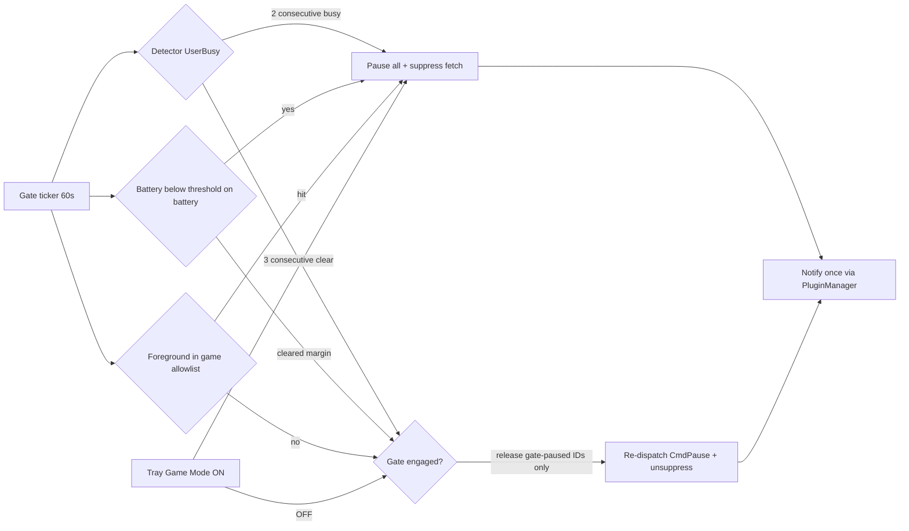

# Activity Gate — Cross-Platform Design Discussion (v2 — hardened detection)

> **Feature**: Pause During Games & Presentations + Battery Saver (Milestone 3.0, Engine Intelligence)
> **Question under discussion**: How do we build this so it works on **Windows today**, **macOS today**, and **Linux** when Wayland support lands in v3.2?
> **Revision note (v2)**: v1 relied primarily on `SHQueryUserNotificationState` for Windows. That alone is **not sufficient** to reliably detect modern games — see §5 for the four-signal redesign and the honest per-scenario detection matrix.

---

## 1. The problem in one sentence

Spice must detect "the user is in a game / presenting / on low battery" and **stop rotating and stop downloading**, then resume automatically — without breaking the Actor model, the lock hierarchy, or the deferred-save UI contract.

## 2. The one design decision that makes cross-platform work

**Do not put any OS-specific detection in the engine.** The engine already has the perfect precedent: `pkg/sysinfo` exposes one pure-Go, build-tagged API per platform (`GetScreenDimensions`, `GetOSDisplayScale`, `IsRemoteSession`, `CanCreateWindows`), and the engine consumes the *interface*, not the syscall. The Activity Gate copies that pattern exactly.

```text
┌──────────────────────────────────────────────────────────────┐
│ pkg/wallpaper/activity_gate.go      (pure Go, zero OS calls) │
│   - decision logic, hysteresis, ownership, ticker            │
│   - depends only on: activity.Detector (interface)           │
├──────────────────────────────────────────────────────────────┤
│ pkg/activity/activity.go            (port, no build tags)    │
│   type Detector interface {                                  │
│       UserBusy() BusyState                                   │
│       Battery() BatteryState                                 │
│       ForegroundProcess() (name string, ok bool)             │
│   }                                                          │
├──────────────────────────────────────────────────────────────┤
│ pkg/activity/windows.go   //go:build windows                 │
│   Signal 1: SHQueryUserNotificationState                     │
│   Signal 2: Foreground window geometry/style heuristic       │
│   Signal 3: Foreground process name (for user allowlist)     │
│   GetSystemPowerStatus for battery                           │
├──────────────────────────────────────────────────────────────┤
│ pkg/activity/darwin.go    //go:build darwin                  │
│   Signal 1: CGWindowList layer-0 full-cover classification   │
│   Signal 3: Frontmost app bundle/exe name (allowlist)        │
│   `pmset -g batt` for battery                                │
├──────────────────────────────────────────────────────────────┤
│ pkg/activity/linux.go     //go:build linux                   │
│   Stub (BusyNone, NoBattery) until v3.2 Wayland milestone;   │
│   later: per-DE fullscreen IPC (swaymsg/hyprctl/kwin) +      │
│   UPower D-Bus battery                                       │
└──────────────────────────────────────────────────────────────┘
```

This mirrors how `pkg/hotkey` is already structured (`hotkey_windows.go` / `hotkey_darwin.go` / `hotkey_linux.go` stub returning "disabled on Linux"), so Linux shipping as a silent no-op stub is a **normal pattern in this codebase**, not a compromise.

### Why a new `pkg/activity` instead of growing `pkg/sysinfo`
- `sysinfo` is *static* system facts (resolution, DPI); the Activity Gate is *dynamic session state* polled continuously. Different lifecycle, different mock/testing needs.
- Keeps `sysinfo` stable for the Windows GL probe logic that must never regress.
- A dedicated package gets a dedicated seam for fakes in tests.

## 3. Engine side: the gate is a *policy*, not a new subsystem

Everything the gate does already exists as an engine verb:

| Gate needs to… | Existing engine capability | File |
|:---|:---|:---|
| Pause rotation | `dispatch(-1, CmdPause)` → each actor `togglePause()` persists per `DevicePath` | [`pkg/wallpaper/wallpaper.go`](../../pkg/wallpaper/wallpaper.go), [`monitor_controller.go`](../../pkg/wallpaper/monitor_controller.go) |
| Stop downloads | `RequestFetch()` debounce already refuses new work (+ new `gateSuppressed` flag) | `wallpaper.go` (`RequestFetch`, `stopAllWorkers`) |
| Resume | Re-dispatch `CmdPause` to gate-owned monitors only; clear suppression | as above |
| Tell the user | `wp.manager.NotifyUser(...)` (Notifier) | `pkg/ui/plugin_manager.go` |
| Manual override | Tray checkable item → `gate.ForceEngage()/ForceRelease()` | `MenuSchema` |

So `ActivityGate` is ~250 lines of *decision* logic that owns:

1. **A 60s ticker goroutine** (same lifecycle shape as `StartNightlyRefresh` in [`scheduler.go`](../../pkg/wallpaper/scheduler.go): created in `Activate()`, torn down via a `stop` channel in `Deactivate()`).
2. **Hysteresis** so we never flap: engage after 2 consecutive busy samples (~2 min), release after 3 consecutive clear samples (~3 min). Prevents pause/unpause thrash on loading screens and tab-switching.
3. **Ownership memory**: the gate only ever releases monitors it *itself* paused. If the user manually paused monitor 2 while the gate was active, the gate must not un-pause it on their behalf. Implementation: snapshot `IsMonitorPaused(id)` for every monitor immediately before the gate pauses; on release, re-dispatch `CmdPause` only to the IDs the gate flipped.
4. **Foreground-process allowlist evaluation** (Signal 3): if the foreground process name matches the user's game list → treat as busy regardless of Signals 1/2. This is the *deterministic* guarantee for the user's actual games.
5. **Manual Game Mode toggle** (Signal 4, user-controlled): tray checkable item persists a pref; while on, the gate is engaged regardless of detector output.

### Why "re-pause" instead of a separate gate-level flag
The per-device pause state (`cfg.IsMonitorPaused(DevicePath)`) survives restarts and is already surfaced in the tray. Reusing it means: no new persisted rotation state, the tray stays truthful during a game, and `ManualRecovery`/`WaitingForImages` semantics in `MonitorState` are untouched. **Mitigation for crash-with-persisted-pause**: nightly scheduler calls `gate.ResetIfIdle()` at day change.

## 4. Battery detection specifics

| Platform | Call | Notes |
|:---|:---|:---|
| Windows | `GetSystemPowerStatus` (lazy-proc, pattern from [`pkg/sysinfo/windows.go`](../../pkg/sysinfo/windows.go)) | `ACLineStatus == 1` → on AC; `BatteryLifePercent` 0–100; `255` = unknown → `NoBattery` |
| macOS | `pmset -g batt` parse (no cgo needed) — same shell-out pattern as `system_profiler` in [`pkg/sysinfo/macos.go`](../../pkg/sysinfo/macos.go) | `(\d+)%` + `discharging`; missing battery → `NoBattery` |
| Linux (later) | UPower over D-Bus (`godbus/dbus/v5` already an indirect dep) | Stub now |

Threshold semantics: user picks 10/15/20/25% via `schema.SelectItem` (integer-index binding per the v3.0 audit rule — never string round-tripping). Trigger when `!onAC && pct <= threshold`; release only at `threshold + 10` or AC restored. Desktops (no battery) silently skip.

## 5. Gaming/presentation detection — the honest four-signal design

**The v1 plan was over-optimistic about Windows.** Correction and full picture:

### Windows caveats that force multi-signal
- `QUNS_RUNNING_D3D_FULL_SCREEN` fires only for **exclusive-mode** Direct3D apps. Since Windows 10's "Fullscreen Optimizations" (FSO), most modern games that users select "Fullscreen" on actually run **borderless** — the shell often reports `QUNS_BUSY`, but not universally.
- **Borderless-windowed** games chosen manually in game settings are the least reliably detected by the shell API alone.
- `QUNS_BUSY` also fires for browser F11, slideshows, and fullscreen video — desired for "presentation" semantics, but means "busy" ≠ "game". That's acceptable: rotation/download pause during fullscreen video is desirable (user is watching; bandwidth is contested).
- **Must NOT be treated as busy**: `QUNS_NOT_PRESENT` (2: screensaver/locked — user away; rotating is harmless and pausing could leave a stale wallpaper) and `QUNS_QUIET_TIME` (6: scheduled Do-Not-Disturb hours — not activity).

### The four Windows signals (combined by the detector)
| # | Signal | Implementation | Catches | Blind spot |
|:---|:---|:---|:---|:---|
| 1 | Shell notification state | `SHQueryUserNotificationState` → busy on `QUNS_BUSY(1)`, `QUNS_RUNNING_D3D_FULL_SCREEN(3)`, `QUNS_PRESENTATION_MODE(4)`, `QUNS_APP(7)`; ignore `NOT_PRESENT(2)`/`QUIET_TIME(6)` | Exclusive D3D games, UWP/Store games, FSO games (usually), F11/slideshow/video | Some manual-borderless setups |
| 2 | Foreground fullscreen geometry | `GetForegroundWindow()` → `GetWindowRect` ≥ 98% of any monitor rect **and** popup/borderless style (`WS_CAPTION` absent) | Manual-borderless games, kiosk-style apps | Windowed games; false-positive risk mitigated by requiring exact cover + no caption |
| 3 | Foreground process allowlist | `GetForegroundWindow` → `GetWindowThreadProcessId` → `QueryFullProcessImageName` → compare against user's game list | **Deterministic** for known games (e.g. `cs2.exe`, `eldenring.exe`) — 100% reliable for the games the user names | Only games the user listed |
| 4 | Manual Game Mode toggle | Tray checkable item → persisted pref → `ForceEngage()` | Anything, on demand | User must remember it (notification on engage/remind keeps it visible) |

**Decision rule (Windows)**: busy := (S1 busy) OR (S2 fullscreen-geometry) OR (S3 allowlist hit) OR (S4 manual on).

### macOS
| # | Signal | Implementation | Notes |
|:---|:---|:---|:---|
| 1 | Layer-0 full-cover window | `CGWindowListCopyWindowInfo` (cgo, precedent: `hotkey_darwin.go`): any **layer 0** window, owner ≠ Spice, covering ≥98% of any display, owner not in system exclusions (`Dock`, `WindowServer`, `SystemUIServer`, `Control Center`) → `BusyFullscreen` | Catches native-fullscreen apps/games/borderless games/video. macOS fullscreen hides menu bar → true fullscreen is distinguishable from "maximized" (which keeps the menu bar visible on macOS) |
| 2 | Frontmost app allowlist | `osascript` System Events frontmost process name (no extra entitlements) or NSWorkspace via cgo; compared against the same shared game list | Deterministic per-app override |
| 3 | Manual Game Mode | same tray toggle | |

### Linux (v3.2 activation)
Per-DE IPC is the clean signal: `swaymsg -t get_outputs`/`hyprctl activewindow` expose fullscreen directly; KDE via KWin script; GNOME via D-Bus `org.gnome.Shell` where permitted. Until then: **stub returns BusyNone** (gate stays a no-op; battery signal still valuable on Linux laptops once UPower lands).

### Shared allowlist UX (all platforms)
- Pref: `GateGameProcessesPrefKey` — user-editable comma-separated process/app names (`TextItem`, e.g. `cs2.exe, eldenring.exe, fallout4.exe`). Empty by default.
- The **smoke util gets a `watch` mode** printing foreground process + busy state continuously, so users (and we) can discover exact names for their games on real hardware.
- Documentation lists common game executables as a starting reference.

## 6. Preferences & UI (fits the existing schema engine unchanged)

New keys in [`pkg/wallpaper/const.go`](../../pkg/wallpaper/const.go):

```go
PauseWhenBusyPrefKey     = pluginPrefix + "pause_when_busy_key"      // bool, default true
BatterySaverPrefKey      = pluginPrefix + "battery_saver_key"        // bool, default true
BatterySaverLevelPrefKey = pluginPrefix + "battery_saver_level_key"  // int index (10/15/20/25%), default 20%
GameModePrefKey          = pluginPrefix + "game_mode_key"            // bool manual toggle, default false
GateGameProcessesPrefKey = pluginPrefix + "gate_game_processes_key"  // string allowlist, default ""
GateGraceMinutesPrefKey  = pluginPrefix + "gate_grace_key"           // int, default 2
```

UI: new "Activity" section in the wallpaper engine panel (`ui_builder.go`) — 2× `schema.BoolItem`, 1× `schema.SelectItem` (battery level), 1× `schema.TextItem` for the game process list, 1× `schema.TextItem{IsNumeric:true}` for grace minutes. **No `NeedsRefresh` on any item** — the gate changes rotation state, not pixels, so no derivative invalidation may fire. Game Mode additionally gets a **tray checkable item** (`MenuSchema`, `IsChecked`).

## 7. Testing strategy

- **Pure-logic tests** (CI-safe): gate transitions, hysteresis, ownership, allowlist matching, grace period — against a `FakeDetector` whose `ForegroundProcess()` returns scripted names. Same mock style as [`mock_prefs_test.go`](../../pkg/wallpaper/mock_prefs_test.go).
- **Parser/classifier tables**: all detection logic extracted into pure functions (`ParseUserNotificationState`, `ParsePowerStatus`, `ParsePmsetOutput`, `IsFullscreenGeometry`, `MatchesProcessList`, macOS `ClassifyWindow`) — 100% table-testable without OS.
- **Real-hardware verification**: `cmd/util/activity_probe` gains `watch` mode; run on the Windows dev box against a detection matrix:

| Scenario | Expected |
|:---|:---|
| Exclusive-D3D game fullscreen | Busy (S1) |
| FSO "Fullscreen" game (Win10/11 default) | Busy (S1 or S2) |
| Manual borderless-windowed game | Busy (S2 or S3) |
| Windowed game, not allowlisted | Not busy — documented limitation; user adds to list (S3) |
| Browser F11 / YouTube fullscreen | Busy (S1) |
| PowerPoint presenter mode | Busy (S1 `PRESENTATION_MODE`) |
| Locked / screensaver | **Not** busy (explicitly ignored) |
| Quiet hours active | **Not** busy |
| Game process in allowlist (windowed!) | Busy (S3, deterministic) |
| Game Mode tray toggle on | Busy always |

## 8. Explicit constraints honoured

| Golden rule | How the gate stays compliant |
|:---|:---|
| Lock hierarchy | Gate holds no engine locks while dispatching; `dispatch()` takes `monMu.RLock()` internally. Ticker pointer swaps under `downloadMutex`, mirroring `stopNightlyRefresh`. |
| Fyne main thread | Gate never calls Fyne; tray toggle rebuild goes through existing tray rebuild path; notifications via `Notifier`. |
| No provider shuffle / pipeline change | Gate touches pause + fetch gating only. Zero store/pipeline edits. |
| Deferred-save UI | Plain `ApplyFunc` prefs; no `NeedsRefresh`. |
| Deactivate drain | `stop` channel closed in `Deactivate()` exactly like `stopNightlyRefresh`. |

## 9. Decisions & open items

Locked (from v1 discussion + this revision):
1. Ship **on by default**; 2. no-battery platforms silently skip; 3. **one PR**, three internal commits; 4. **four-signal detection** (shell state + geometry + allowlist + manual toggle); 5. `NOT_PRESENT`/`QUIET_TIME` explicitly ignored.

Open (user input welcome, not blocking):
- Per-monitor pause targeting (game fullscreen on monitor 2 pauses only that monitor) — deferred; global pause for v3.0.0.


