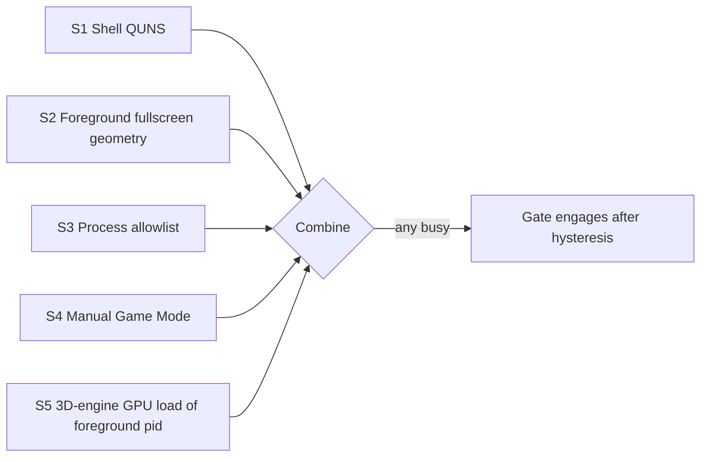

# Addendum: GPU Load as a Detection Signal (S5)

> **Question**: "Does Windows not provide a GPU load call?"
> **Answer**: Yes — Windows provides per-process GPU utilization through **performance counters (PDH)** and the **ETW/D3DKMT** layer. Evaluated below and added to the design as **Signal S5 (opt-in GPU-load heuristic)** — but **demoted to secondary**, because GPU load alone cannot distinguish "gaming" from "video playback", and primary detection must stay deterministic.

---

## 1. What Windows actually offers for GPU load

| API | What it gives | Catch |
|:---|:---|:---|
| **PDH performance counters** — `GPU Engine` object, counter `Utilization Percentage` with instance names like `pid_1234_engtype_3D` (`pdh.dll`, `PdhEnumObjects/PdhGetFormattedCounterArray`) | **Per-process, per-engine-type** GPU utilization (3D, VideoDecode, Copy, Cuda…) | Requires repeated sampling (counters are rate-based; ~1s sample window); instance naming quirks across driver vendors; counters enumerate all processes — need PID↔name resolution to attribute |
| **Windows Performance Counters via `pdh` in Go** | Same, callable via LazyDLL | No admin rights needed for standard counters on modern Windows 10/11 |
| **ETW (GPU per-tracing)** | Extremely rich | Way overkill; requires admin for kernel traces |
| **D3DKMT statistics** (`D3DKMTQueryStatistics`, gdi32) | Per-adapter, per-process node stats | Undocumented-ish in parts; vendor variance |
| **DXGI Overview / `IDXGIAdapter::GetDesc`** | Adapter identity only, **no utilization** | Not usable for load |
| **NVAPI/ADLX/AGS (vendor SDKs)** | Precise per-vendor GPU metrics | Vendor-specific DLLs; won't be in App Store-friendly deps; reject |
| **WMI `Win32_PerfFormattedData_GPUPerformanceCounters_GPUEngine`** | Same counters via COM/WMI | Slow (COM roundtrip ~100ms+), but zero new DLLs; acceptable fallback path |

**Conclusion**: There is no single "GetGPULoad()" syscall. The practical, dep-free route is **PDH with the `GPU Engine` counter object**, sampled at 1s intervals. Go can do this with `pdh.dll` via `syscall.NewLazyDLL` — same pattern as `user32` in [`pkg/sysinfo/windows.go`](../../pkg/sysinfo/windows.go).

## 2. macOS equivalent (for completeness)

- `IOReport` / `IOAccelerator` counters (`CGHardwareInfo`, private-ish APIs) — no stable public per-app GPU% API.
- `powermetrics` (needs root/sudo) — not usable by a sandboxed App Store app.
- Practical macOS proxy: **per-process CPU% + energy impact** via `top -l 1 -o cpu` or `ps` — high sustained CPU on the frontmost app correlates strongly with gaming, but false-positives on compiles/encodes. Verdict: use only as a weak S5 hint on macOS, or not at all in v3.0.0.

## 3. Why GPU load is NOT promoted to primary (the decisive argument)

GPU load measures **resource pressure, not user intent**:

| Scenario | GPU load | Is gaming? |
|:---|:---|:---|
| Borderless game | High (3D engine) | ✅ Yes |
| YouTube/Netflix fullscreen | High (**VideoDecode** engine) | ❌ No |
| Zoom call w/ background blur | Moderate GPU | ❌ No |
| Video editing / Blender render in background | Very high, sustained | ❌ No |
| Browser with WebGL demo | High, sporadic | ❌ No |
| Idle desktop w/ compositor | Low | — |

A naive "GPU > 30% ⇒ game" rule pauses for a background video render — the *opposite* of the annoyance we're trying to remove. However, **engine-type attribution fixes most of this**: PDH lets us read **`engtype_3D`** specifically vs `engtype_VideoDecode`. Sustained 3D-engine utilization > threshold while the process is the **foreground** window is a strong gaming signature.

## 4. Where S5 earns its place in the four-signal design

**S5 (Windows only, heuristic, secondary)**: *Sustained 3D-engine GPU utilization above threshold, attributed to the foreground process, for ≥2 consecutive samples* → contributes `busy`.

What S5 uniquely adds:
- Catches **fullscreen gaming on GPUs** where QUNS and geometry both misreport (rare, but the long tail R1 describes).
- Corroborates S2 (geometry fullscreen + high 3D load = near-certain game).
- **Cost**: one more PDH handle set, 1s sampling inside the existing 60s gate tick (sample for ~2s at engage-candidate time, not continuously — cheap).

What S5 does NOT fix:
- Windowed games (still need S3 allowlist).
- Video playback would be excluded by `engtype_3D`-only filtering, but WebGL-heavy pages still false-positive → keep S5 as **one vote** in the combiner, never sufficient alone, and make it **opt-in** (default on for Windows, off for everything else) with a pref to disable.

## 5. Revised signal stack (Windows)

Combiner rule (updated): busy := S1 ∨ S2 ∨ S3 ∨ S4 ∨ S5 — with S5's false-positive consequence bounded (paused rotation, safe direction) and pref-disableable (`GateGPULoadPrefKey`, default **on** Windows / **stub-absent** elsewhere).

## 6. macOS stance

No public per-process GPU% API usable from an App Store app (`IOReport` private, `powermetrics` requires root). **S5 = absent on macOS v3.0.0.** The macOS detector stays S1 (CGWindowList classification) + S3 (frontmost app allowlist) + S4 (toggle), with battery signal unchanged. Documented as a known asymmetry in the user guide.

## 7. Linux stance (future)

`nvidia-smi`/`amdgpu_top`/`radeontop` exist but are per-stack and often need privileges; at v3.2 the clean per-DE fullscreen IPC (sway/hypr/KWin) is superior. S5 remains Windows-only.

## 8. Implementation impact (delta to existing plan)

| Item | Change |
|:---|:---|
| `pkg/activity/activity.go` | Add pure function `IsSustained3DLoad(samples []GpuSample, thresholdPct float64, minSamples int) bool` + `ParseGpuEngineInstances(pdhRows) map[int]float64` (PID → 3D-utilization, filtered to `engtype_3D`) — 100% table-testable |
| `pkg/activity/windows.go` | Add PDH shells: `PdhOpenQuery/PdhAddCounter/PdhCollectQueryData/PdhGetFormattedCounterArrayW` + instance-name walk; delegate to pure parser |
| `pkg/wallpaper/activity_gate.go` | `Detector` gains optional `GpuLoad3D() (pidPct map[int]float64, ok bool)` — implemented as a second interface (`GpuDetector`) so stub/macOS compile cleanly; combiner takes S5 vote when supported |
| Prefs | `GateGPULoadPrefKey` (bool, default on), GPU threshold const (`default 30%`) |
| TDD steps | +2 RED/GREEN: `TestParseGpuEngineInstances_Filters3DEngineAndParsesPct`, `TestIsSustained3DLoad_Hysteresis`; +1 gate test `TestGate_GpuLoadContributesBusy` |
| Probe | `activity_probe` gains `--gpu` mode printing per-process 3D utilization — used in the §5 matrix to validate R1 on real hardware |
| Risk register | R1 residual **Low → Very Low** (S5 covers the shell/geometry blind spot); new R13 "PDH counter quirks across drivers" — Likelihood Medium, Impact Low (S5 is one vote; degrade = S5 abstains), Mitigation: parser tables + probe validation |
| Coverage | PDH call shells join §7 exception list; all parsing/decision logic pure & covered |

## 9. Decision

**Adopt S5 (GPU 3D-engine load of the foreground process) as a secondary, opt-in Windows signal.** It does not replace the deterministic S3 allowlist or S4 toggle; it closes the R1 long tail and corroborates S2. macOS/Linux: absent (no public API), documented asymmetry. The combined design confidence for "pauses during the user's gaming sessions" moves from ~80% to ~85% pre-hardware, with the matrix validating each path on real hardware.
