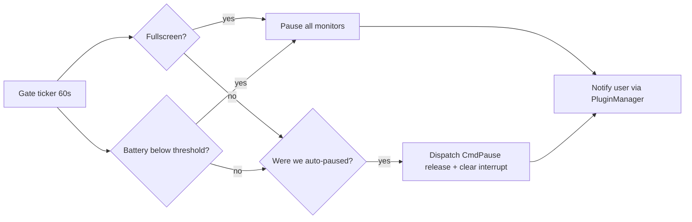

# Feature Priority Decision — What to Build First

> **Question**: Objectively, which roadmap item should be implemented first?
> **Answer**: The Milestone 3.0 "Engine Intelligence" pair — **Pause During Games & Presentations + Battery Saver** — implemented as one shared *Activity Gate*.

---

## 1. Decision & Rationale

### Recommended first: Activity Gate (Pause During Games + Battery Saver)

| Criterion | Assessment |
|:---|:---|
| **Existing machinery** | Pause plumbing already exists end-to-end: `MonitorState.Paused`, `CmdPause`, `togglePause()` in [`pkg/wallpaper/monitor_controller.go`](../pkg/wallpaper/monitor_controller.go), `Plugin.IsPaused()` / `IsMonitorPaused()` and per-device persistence `cfg.IsMonitorPaused(DevicePath)` ([`pkg/wallpaper/wallpaper.go`](../pkg/wallpaper/wallpaper.go)). Download suppression hooks also exist (`interrupt` flag, `RequestFetch` debounce in `wallpaper.go`). |
| **New code surface** | Small and additive: one gate module + two OS detectors + a prefs section. No schema upheaval, no store/pipeline changes, no cache invalidation risk. |
| **User value** | High and immediate: the #1 complaint class for background wallpaper tools is rotation/bandwidth interrupting gaming or presentations, and battery drain on laptops. |
| **Regression risk** | Low — the gate only *invokes* existing pause paths; no hot-path locking changes. Respects the golden rule of never holding `monMu` into Fyne. |
| **Sequencing leverage** | Establishes the "automatic trigger → existing Actor command" pattern that Monitor Fingerprinting and Solar Filtering will reuse later. |

### Why not the others first (objective ranking)

| Rank | Item | Why not first |
|:---|:---|:---|
| 2 | **Hotkey modifier remap** (open todo) | Smallest, well-specified quick win (`TargetedModifierPrefKey` + dropdown + `pkg/hotkey` mapping), but narrow user value; ideal warm-up or parallel task, not the headline. |
| 3 | **Color extraction** (v3.1) | Self-contained and simple (dominant colors of current wallpaper → JSON), but lower strategic value than 3.0 engine features. |
| 4 | **Monitor Fingerprinting** (v3.0) | Highest user value of the milestone but the largest architectural lift: per-monitor query assignment touches Config schema, `MonitorState`, store filtering, and the settings UI. Should follow, not lead. |
| 5 | **Solar Filtering / Dark Mode** (v3.0) | Coupled to the image-processing hot path and needs a new `ProcessingFlag` → risks derivative-cache thrash on 4K images; better after worker telemetry exists. |
| 6 | **Store save batching / Worker telemetry** | Internal-only; no user-visible payoff; fold in opportunistically. |
| 7 | **.artwalk tours / Wayland / Custom scripts** | New content format, new OS platform, and an arbitrary-code-execution security surface respectively — all last. |

---

## 2. Implementation Sketch — Activity Gate

### 2.1 New module: `pkg/wallpaper/activity_gate.go`
- `ActivityGate` struct: evaluates trigger conditions on a 60s ticker goroutine owned by the `Plugin` (lifecycle mirrors `StartNightlyRefresh` in [`pkg/wallpaper/scheduler.go`](../pkg/wallpaper/scheduler.go)).
- Two detectors, both platform-gated:
  - **Fullscreen/presentation**: Windows — `SHQueryUserNotificationState` (`QUNS_RUNNING_D3D_FULL_SCREEN`, `QUNS_APP`, `QUNS_BUSY`); macOS — frontmost app full-screen via `NSWorkspace`/CGWindowList.
  - **Battery**: Windows — `GetSystemPowerStatus` (`BatteryLifePercent`, `ACLineStatus`); macOS — `pmset -g batt` or IOPSCopyPowerSourcesInfo.
- Actions on trigger: dispatch `CmdPause` to every monitor through the existing `wp.dispatch()` path and set the download interrupt so `RequestFetch()` no-ops; release symmetrically when conditions clear.
- Never touches Fyne directly; notifications go through `wp.manager.NotifyUser`.

### 2.2 Preferences (`pkg/wallpaper/const.go` + schema panel)
- New keys: `PauseWhenFullscreenPrefKey`, `BatterySaverPrefKey`, `BatterySaverThresholdPrefKey`.
- New `schema.BoolItem` / `schema.SelectItem` entries in the existing App/engine settings tab; `ApplyFunc` only — the Registry Pattern handles dirty tracking and auto-save.

### 2.3 Tests
- Gate decision unit tests (no OS dependency): trigger transitions, hysteresis (no flap), deactivation drain.
- Follow the existing patterns in `pause_test.go` and `mock_prefs_test.go`.

